<p align="center">
  
</p>

# JS Bay

JS Bay is a Zig package and typed C ABI for embedding QuickJS-NG, QuickJS, or JavaScriptCore. Select the backend at build time; the C API and platform SDKs keep the same instance, value, timer, and callback model.

## Quick start

Use Zig 0.17 and clone vendor submodules:

```sh
git submodule update --init --recursive
zig build -Dbackend=quickjs_ng
zig build test
```

Supported backend tags are `quickjs_ng`, `quickjs`, and `jsc`. JavaScriptCore requires an Apple target. Experimental Escargot / Hermes spikes also live as submodules (`vendor/escargot`, `vendor/hermes`); see below.

The public C header is [`include/jsbay.h`](include/jsbay.h). Create and use each engine on one owner thread, release every owned `jsbay_value_t`, and destroy the engine on that same thread. `jsbay_engine_request_interrupt` and `jsbay_engine_stop_loop` are the ordinary cross-thread controls.

```c
#include "jsbay.h"

const uint8_t source[] = "1 + 2";
const uint8_t filename[] = "app.js";
jsbay_value_t value = 0;
jsbay_value_t exception = 0;

if (!jsbay_engine_create(1, NULL, NULL)) return 1;
jsbay_status_t status = jsbay_engine_evaluate(
    1,
    (jsbay_utf8_t){source, sizeof(source) - 1},
    (jsbay_utf8_t){filename, sizeof(filename) - 1},
    NULL, &value, &exception);
if (status == JS_BAY_OK) jsbay_value_release(value);
if (status == JS_BAY_EXCEPTION) jsbay_value_release(exception);
jsbay_engine_destroy(1);
```

The JavaScript event loop owns its monotonic clock, timers, waiting, and wakeups. Call `jsbay_engine_run_loop` on a dedicated owner thread, or let the SDK connect it to the platform owner thread. `jsbay_engine_stop_loop` is thread-safe. Each queued JavaScript task finishes with a microtask checkpoint; callers do not supply timestamps or compute deadlines.

## SDKs and integration

The Android, Apple, .NET, and Harmony SDKs wrap the same typed C ABI. Installation and platform build details are in their SDK directories.

- [Android](sdk/android)
- [Apple](sdk/apple)
- [.NET](sdk/dotnet)
- [Harmony](sdk/harmony)

Read [the API contract](docs/api-contract.md) before implementing a binding or callback. It defines value ownership, errors, thread affinity, callbacks, cache behavior, and the optional synchronous-native extension. [Embedding](docs/embedding.md) gives the lifecycle checklist.

## Documentation

Start with the [documentation index](docs/readme.md). The most commonly needed guides are [embedding](docs/embedding.md), [runtime limits](docs/runtime-limits.md), [backend selection](docs/embedding.md#backend-selection), and [Inspector setup](docs/inspector.md).


## Experimental backends

`-Dbackend=escargot` and `-Dbackend=hermes` are experimental spikes, not a
stable ABI. Sources are git submodules (`vendor/escargot`, `vendor/hermes`);
install prefixes stay local and gitignored. Capability tables, pinned SHAs, and
build notes: [docs/capability.md](docs/capability.md). Default remains QuickJS-NG.

## License

JS Bay is licensed under the [MIT License](LICENSE). Bundled artifacts and source releases include [third-party notices](THIRD_PARTY_NOTICES.md).
